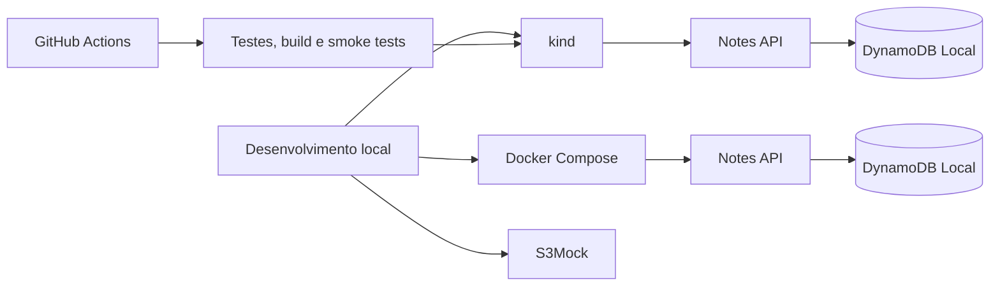

# spring-aws-k8s-lab


Lab local de estudo: uma API de notas em **Spring Boot**, **Docker** e **Kubernetes** com **kind**, sem provisionar recursos na AWS.

O projeto é construído em fases pequenas, uma tecnologia por vez. Como rodar a aplicação: [`docs/executando.md`](docs/executando.md).

## Arquitetura local



O S3Mock é independente da API e serve para praticar operações compatíveis com parte da API S3. O CI valida os arquivos Terraform sem planejar ou criar recursos AWS.

## Roteiro

| Etapa | Conteúdo | Estado |
|-------|----------|--------|
| 1 | API Spring Boot, testes, Docker Compose e DynamoDB Local | ✅ concluída |
| 2 | kind, Deployments, Services, ConfigMap, probes, S3Mock e smoke tests no CI | ✅ concluída |
| Próximos estudos | Operar o cluster local: logs, eventos, probes, rollout e troubleshooting | Opcional |

Provisionamento AWS, incluindo S3, EC2, ECR, DynamoDB gerenciado e EKS, foi removido do roteiro para evitar cobranças. Os manifests e arquivos Terraform existentes são material de estudo; não rode `terraform apply` nem crie recursos na AWS neste lab.

## Estrutura

```
.
├── app/            # API Spring Boot (Maven wrapper, Dockerfile, testes)
├── k8s/            # manifests Kubernetes local (kind)
├── terraform/      # exemplos validados estaticamente; sem apply
├── docs/           # documentação de execução e configuração
└── compose.yaml    # ambiente local: API + DynamoDB Local
```

## Rodando localmente

Requisitos: Docker. Para a fase Kubernetes, também `kind`, `kubectl`, `curl` e `jq`. O smoke test do S3Mock requer AWS CLI. Para rodar os testes ou a API fora do container, Java 25. Maven não é necessário, porque o projeto usa o wrapper `./mvnw`.

```bash
docker compose up --build

# em outro terminal
curl -X POST localhost:8080/notes -H 'Content-Type: application/json' \
  -d '{"title":"primeira nota","content":"oi"}'
curl localhost:8080/notes
```

Testes de integração (sobem o DynamoDB Local via Testcontainers, então precisam do Docker rodando):

```bash
cd app && ./mvnw test
```

### Kubernetes local (fase 2, concluída)

```bash
kind create cluster --name lab
docker build -t notes-api:0.1.0 ./app
kind load docker-image notes-api:0.1.0 --name lab
kubectl create namespace lab
kubectl apply -f k8s/
kubectl rollout status deployment/dynamodb -n lab
kubectl rollout status deployment/s3mock -n lab
kubectl rollout status deployment/notes-api -n lab
./scripts/smoke-test-kind.sh
./scripts/smoke-test-s3mock.sh
```

O S3Mock fica disponível dentro do cluster em `http://s3mock:9090`, com o bucket `notes-local`. Ele implementa apenas parte da API S3 e guarda os objetos localmente; não cria nem acessa recursos AWS. Os dados são de laboratório e podem sumir ao recriar o Pod.

Este lab não precisa de credenciais AWS. O CI não executa `terraform plan` nem `terraform apply`.

Depois de reconstruir a imagem com a mesma tag ou alterar o ConfigMap, atualize o cluster:

```bash
kind load docker-image notes-api:0.1.0 --name lab
kubectl apply -f k8s/
kubectl rollout restart deployment/notes-api -n lab
kubectl rollout status deployment/notes-api -n lab
```

## API

| Método | Rota | Descrição |
|--------|------|-----------|
| `POST` | `/notes` | cria nota (`title` obrigatório, até 200 caracteres) |
| `GET` | `/notes` | lista notas |
| `GET` | `/notes/{id}` | busca nota; `404` se não existir |
| `DELETE` | `/notes/{id}` | remove nota |
| `GET` | `/actuator/health/liveness` | liveness probe |
| `GET` | `/actuator/health/readiness` | readiness probe |
| `GET` | `/actuator/prometheus` | métricas no formato Prometheus |

## Decisões de projeto

- **DynamoDB Local:** permite praticar a integração com o AWS SDK sem criar uma conta ou tabela AWS.
- **Sem credenciais AWS:** Compose e Kind apontam para emuladores locais; não configure chaves AWS neste lab.
- **Configuração por variável de ambiente:** a mesma imagem roda no Compose e no `kind`.
- **Imagem multi-stage, usuário não-root** e heap da JVM dimensionado pelo limite de memória do container.
- **Testes contra DynamoDB Local** com Testcontainers, em vez de mocks.

## Stack

Java 25 · Spring Boot 4 · AWS SDK v2 (DynamoDB Enhanced Client) · JUnit 5 · Testcontainers · Docker · Kubernetes (`kind`)
