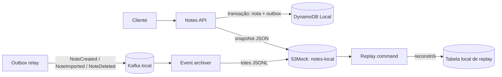

# Exportação e arquivo de eventos de notas — desenho

## Intenção

Dar ao bucket S3Mock um uso de produto que combine com a API de notas: exportar e importar conjuntos de notas, e guardar eventos Kafka para auditoria e reconstrução do estado. Tudo deve rodar localmente, sem conta AWS, credenciais reais ou recursos pagos. A fronteira do domínio de arquivo deve permitir extração futura para um microsserviço.

## Contexto atual

- A Notes API é um monólito Spring Boot com operações de criar, listar, consultar e excluir notas; ainda não há edição.
- As notas ficam no DynamoDB Local. A tabela não é persistida pelo Compose atual, que inicia DynamoDB Local em memória.
- S3Mock 5.2.3 e o bucket `notes-local` já existem no `kind`, mas a API não usa o serviço. O Compose atual não inicia S3Mock.
- O smoke test existente verifica upload e download simples via AWS CLI.
- Não há Kafka nem publicação de eventos hoje.

## Objetivos

- Exportar notas para um objeto versionado em formato JSON e restaurá-las posteriormente.
- Registrar `NoteCreated`, `NoteImported` e `NoteDeleted` no Kafka, com os dados necessários para auditoria e reconstrução.
- Arquivar os eventos em objetos JSONL no S3Mock, em lotes identificáveis e reprocessáveis.
- Reconstruir notas em uma tabela DynamoDB Local separada a partir do arquivo de eventos, sem sobrescrever a tabela ativa.
- Executar os componentes em Compose e `kind`, com dados em armazenamento local persistente para o arquivo S3.
- Manter tudo local e sem dependência da AWS.

## Fora de escopo

- Acessar ou criar recursos AWS, incluindo Terraform apply.
- Usar S3 para imagens ou anexos de notas.
- Fazer do Kafka o banco primário das notas ou introduzir Kafka Connect.
- Implantar agora um microsserviço separado.
- Alterar ou adicionar edição de notas nesta entrega.

## Abordagens consideradas

1. **Um objeto S3 por evento:** fácil de inspecionar, mas gera muitos objetos e torna a gestão de ordenação e replay trabalhosa.
2. **Lotes JSONL por tópico, partição e intervalo de offsets:** escolhido. Mantém o número de objetos controlado e permite verificar sequência e retomar um lote de modo idempotente.
3. **Guardar só snapshots periódicos das notas:** mais simples, mas não fornece o histórico de eventos nem permite reconstruir mudanças intermediárias.

Exportações de notas são snapshots sob demanda; o arquivo de eventos é um fluxo separado. O snapshot atende backup e portabilidade. Os eventos atendem auditoria e reconstrução detalhada.

## Arquitetura proposta

O armazenamento continua sendo DynamoDB Local; S3Mock guarda snapshots e arquivo imutável dos eventos. A API escreve cada mudança de nota e seu evento de outbox na mesma transação DynamoDB. Um relay publica itens pendentes no Kafka; republicação é possível e esperada em falhas, então cada evento tem `eventId` estável para deduplicação. A chave Kafka é `noteId`, mantendo eventos da mesma nota na mesma partição e em ordem.

O consumidor agrupa eventos por tópico e partição. Cada lote é um objeto JSONL determinístico a partir do intervalo de offsets e inclui um manifesto com tópico, partição, offsets inicial/final, contagem, versão do esquema e checksum. O offset Kafka só é confirmado depois que o objeto e o manifesto foram gravados. Repetir a gravação do mesmo intervalo sobrescreve a mesma chave de objeto, evitando duplicar lotes após uma falha.

O replayer inicia pelo snapshot-base do arquivo, depois lê manifestos e objetos posteriores, valida lacunas/checksums, ordena por partição e offset e aplica eventos a uma tabela de destino vazia e dedicada. Ele não altera a tabela ativa. `NoteDeleted` inclui snapshot dos dados removidos para auditoria; no replay, o evento remove a nota do estado reconstruído. `NoteCreated` e `NoteImported` carregam o snapshot completo da nota.

Ao ativar o arquivo, as notas já existentes entram em um snapshot-base no S3. Para registrar um limite confiável, a Notes API pausa temporariamente as escritas, o relay e o consumidor drenam o que estiver pendente, o snapshot-base é gravado com os próximos offsets Kafka por partição e então as escritas são retomadas. O replay usa esses offsets para aplicar apenas eventos posteriores ao snapshot. O procedimento é local e pode ser repetido para criar novos pontos de recuperação.

## Exportação e importação

- Exportar as notas cria um objeto JSON com `schemaVersion`, `exportId`, `generatedAt` e os registros completos das notas, incluindo seus IDs.
- O nome do objeto usa um identificador gerado pela aplicação, não valores de entrada do usuário.
- A resposta expõe o `exportId`; o cliente pode baixar o arquivo pela API. Listagem de exportações pode usar prefixo e metadados S3.
- Importação aceita apenas o formato de exportação do projeto, valida o documento antes de gravar e preserva os IDs para permitir restauração.
- Colisão de IDs e falha parcial durante uma importação precisam ter resposta explícita e repetível; a implementação deve evitar sucesso parcial silencioso.
- Cada nota importada gera `NoteImported`, tornando a restauração auditável e reconstruível pelo arquivo de eventos.

Rotas candidatas: `POST /exports`, `GET /exports/{exportId}`, `POST /imports`. O contrato final pode ser afinado durante o plano, preservando esses comportamentos.

## Preparação para microsserviço

Organizar o domínio de arquivo em uma fronteira própria: casos de uso de exportação, importação, arquivamento e replay; adaptadores S3 e Kafka próprios; contratos de eventos versionados. Nesta fase o deploy segue no lab atual. A extração futura poderá mover o consumidor Kafka e o acesso ao bucket para um `notes-archive-service`, sem chamadas S3 espalhadas pelos controllers.

## Execução local e persistência

- Compose e `kind` devem usar o mesmo nome de bucket, contratos e configurações por variáveis de ambiente.
- S3Mock deve gravar no diretório configurado e montado em volume local; sem persistência em disco, reiniciar o Pod pode apagar o arquivo que a funcionalidade promete preservar.
- Kafka será um broker local em modo KRaft, suficiente para o lab; não representa alta disponibilidade.
- DynamoDB Local pode permanecer efêmero para as notas ativas. O replay prova a reconstrução ao popular a tabela de destino a partir do arquivo S3 persistente.
- Valores de credenciais do SDK são fictícios e usados só para os emuladores.

## Observabilidade

Expor métricas para eventos pendentes na outbox, falhas e latência de publicação, lag do consumidor, lotes gravados/repetidos/falhos e eventos aplicados no replay. Integrar ao Prometheus e ao Grafana já presentes, sem enviar dados a serviços externos.

## Verificação esperada

- Testes para exportar/importar, esquema inválido, colisão de IDs, publicação duplicada, falha entre gravação S3 e confirmação Kafka, lote repetido, lacuna de offsets, checksum inválido e reconstrução create/delete.
- Integração com S3Mock, DynamoDB Local e Kafka locais; nenhum teste acessa AWS.
- Smoke test exercita exportação/download/importação e confirma replay do arquivo de eventos.
- Compose e manifests `kind` sobem os componentes e mantêm o arquivo S3 através de reinício do Pod/container.
- Checks Maven, formatação, validação dos manifests, smoke tests e CI afetado.

## Decisões de implementação ainda abertas

- A estratégia de importação deve ser atômica para todo o arquivo ou aceitar lotes retomáveis com relatório de resultados?
- O contrato de exportação usa JSON simples ou JSONL para suportar arquivos maiores?
- O replay será um comando administrativo da própria aplicação ou um processo de linha de comando separado?

As decisões acima podem ser resolvidas no plano, desde que preservem restauração segura, auditoria e replay sem afetar a tabela ativa.

## Decisões assumidas neste desenho

- O arquivo precisa reconstruir também as notas existentes antes da ativação do Kafka; por isso há um snapshot-base com offsets de início do replay.
- Durante a criação do snapshot-base, as escritas ficam pausadas até o relay e o arquivador drenarem seus eventos pendentes. Isso mantém o limite entre snapshot e eventos explícito e fácil de verificar no lab.

## Referências técnicas

- [S3Mock: armazenamento em disco e diretório persistente](https://github.com/adobe/S3Mock/blob/main/README.md)
- [Apache Kafka: quickstart oficial](https://kafka.apache.org/quickstart/)
